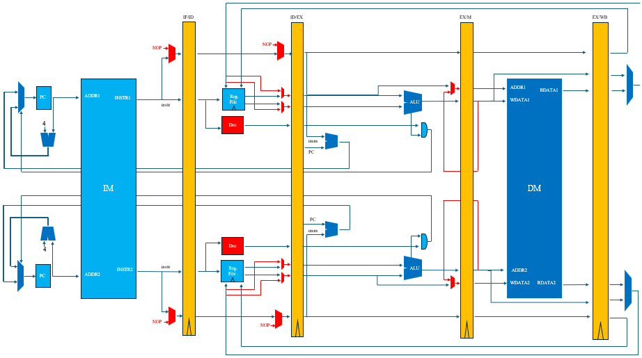
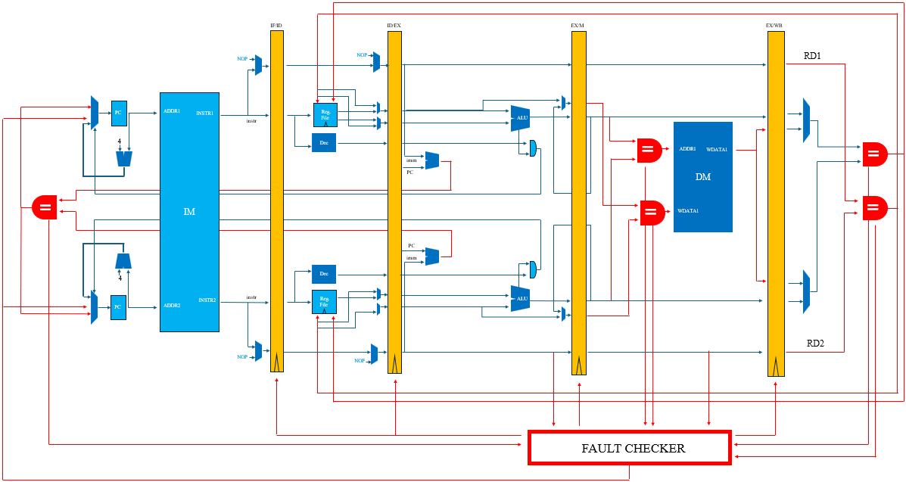
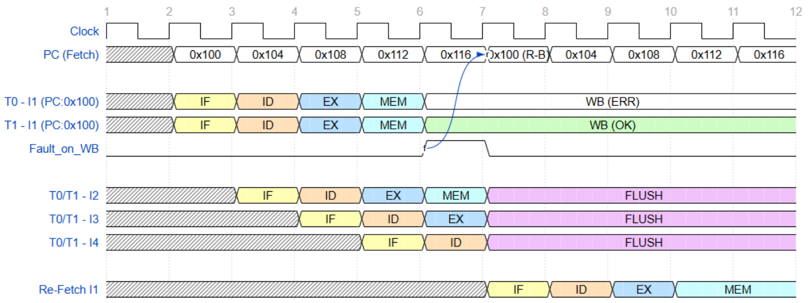
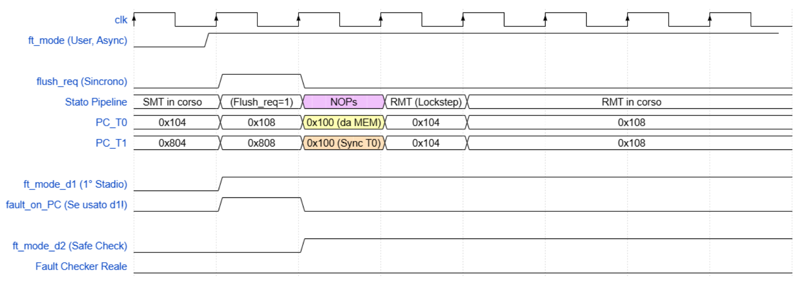
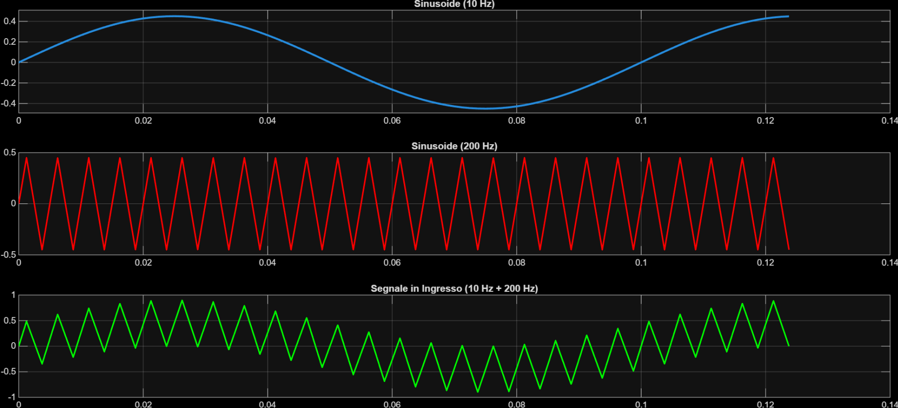
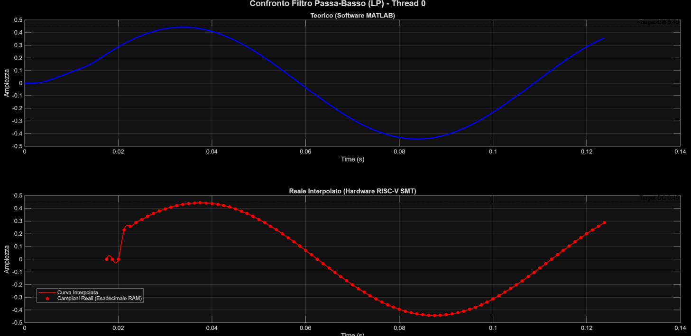

# Fault-Tolerant SMT/RMT RISC-V Processor with Dynamic Mode Switching (DMS) 🚀


-red.svg)
-orange.svg)


A 32-bit, 5-stage pipelined **RISC-V (`RV32IM` subset)** processor developed in VHDL for mission-critical and aerospace applications. The microarchitecture evolves a scalar pipeline into three hardware multi-threaded configurations:
1. **SMT (Simultaneous Multi-Threading):** Dual-thread spatial parallelism (`T0` and `T1`) for maximum DSP throughput.
2. **RMT (Redundant Multi-Threading):** Dual-thread strict lock-step execution with real-time **Commit-Wall Fault Checking** and hardware **Roll-back Recovery** against Single Event Upsets (SEUs).
3. **DMS (Dynamic Mode Switching):** A hybrid adaptive core capable of switching at runtime between high-performance **SMT mode** and radiation-tolerant **RMT lock-step mode** via an external `ft_mode` control signal.

The repository includes a portable CLI simulation manager (`run.sh` + `sim_core.py`), SystemVerilog **Hardware-in-the-Loop (HIL)** testbenches with a customizable **Fault Injection Unit (`FIU.sv`)**, and automated **Matplotlib verification dashboards** (`dms_analyzer.py`, `fir_analyzer.py`, `pid_analizer.py`).

---

## 📋 Table of Contents
1. [Microarchitectural Evolution](#1-microarchitectural-evolution)
2. [Fault Detection & Roll-Back Mechanism (RMT)](#2-fault-detection--roll-back-mechanism-rmt)
3. [Dynamic Mode Switching (DMS Architecture)](#3-dynamic-mode-switching-dms-architecture)
4. [Verification & Benchmarks (DSP & HIL Control)](#4-verification--benchmarks-dsp--hil-control)
5. [FPGA Implementation Results (ZCU208)](#5-fpga-implementation-results-zcu208)
6. [Repository Structure](#6-repository-structure)
7. [Quick Start & Simulation Guide](#7-quick-start--simulation-guide)

---

## 1. Microarchitectural Evolution

### Enhanced 5-Stage Baseline Core
Starting from a classic 5-stage pipeline (*Fetch*, *Decode*, *Execute*, *Memory*, *Write-Back*), the baseline datapath was extended with:
- **`RV32IM` Instruction Subset:** Supports arithmetic/logic operations (`ADD`, `SUB`, `ADDI`, `SRAI`, `SLLI`), memory access (`LW`, `SW`), control flow (`BEQ`, `BNE`, `BLT`, `JAL`), and hardware multiplication (`MUL`, `MULH`).
- **Tightly Coupled Hardware Multiplier:** Dedicated 32×32-bit signed multiplier integrated into the `MEM` stage, presenting its result at the `WB` stage (matching `LW` latency).
- **Hazard Detection & Forwarding Unit:** Full `EX/MEM` and `MEM/WB` bypass network, extended with internal **WB-to-ID forwarding** (allowing simultaneous register read/write in the same cycle) and a **1-cycle hardware stall unit** (`uses_rs1`, `uses_rs2`) to automatically resolve Load-Use and Multiply-Use data hazards without manual NOP insertion.

### Simultaneous Multi-Threading (SMT) Core
The scalar core is expanded into a spatially partitioned dual-thread processor where **Thread 0 (`T0`)** and **Thread 1 (`T1`)** advance concurrently through physically isolated datapaths:
- **Duplicated Architectural State:** Two independent Program Counters (`PC_T0` initialized at `0x00000000`, `PC_T1` initialized at `0x00000400`) and two isolated 32×32-bit Register Files (`RF_T0`, `RF_T1`).
- **Duplicated Execution Resources:** Dual Instruction Decoders in `ID`, dual ALUs and independent Branch Evaluators in `EX`, and dual Hardware Multipliers in `MEM`.
- **Dual-Port Memory Subsystem:** Parameterizable `DualPort_Instruction_ROM` (`rom.vhd`, configurable via `DUAL_PROGRAM_MODE` and `START_INDEX_T1`) and shared `DualPort_Data_RAM` (`ram.vhd`) enabling simultaneous non-blocking instruction fetches and data accesses.



---

## 2. Fault Detection & Roll-Back Mechanism (RMT)

In **RMT mode**, hardware parallelism is traded for **Fault Tolerance**. `T0` and `T1` execute identical firmware in strict lock-step over isolated datapaths (`RMT/core2.vhd`), converging onto a centralized **Fault Checker (`RMT/fault_checker.vhd`)** and a shared **Single-Port Data RAM**.



### Distributed Commit-Walls
Comparators are placed at every architectural state modification boundary (*Commit-Walls*):
- **Execute Commit-Wall (`fault_on_EXE`):** Validates branch and jump execution by comparing target addresses (`EXE_pc_branch_Tx`) and branch taken flags (`EXE_pc_src_Tx`).
- **Memory Commit-Wall (`fault_on_MEM`):** Protects the Data RAM during `SW` instructions by comparing memory addresses (`MEM_alu_res_Tx`), write data (`MEM_read_data2_Tx`), and write enables (`MEM_data_we_Tx`). Also performs **early fault detection** on ALU results for non-store instructions transiting through `MEM`.
- **Write-Back Commit-Wall (`fault_on_WB`):** Protects the Register Files by verifying write data (`WB_data_Tx`), destination register indices (`WB_rd_Tx`), and write enables (`WB_rf_we_Tx`).

### Hierarchical Roll-Back & Recovery
Historical Program Counters (`EXE_PC_Tx`, `MEM_PC_Tx`, `WB_PC_Tx`) propagate along the pipeline stages into the Fault Checker:
1. **Write Inhibition:** Upon any mismatch, the corresponding Commit-Wall immediately blocks `RAM` or `Register File` write-enable signals to prevent state corruption.
2. **Age-Ordered Roll-Back Priority (`WB > MEM > EX`):** If multiple faults occur simultaneously across stages, recovery prioritizes the oldest instruction in flight, loading its address (`FC_PC_RB`) back into both `PC_T0` and `PC_T1` while flushing all younger pipeline stages.
3. **Critical Control-Flow Protection (`fault_on_PC`):** If the thread Program Counters themselves diverge (`EXE_PC`, `MEM_PC`, or `WB_PC` mismatch), deterministic roll-back is impossible. `fault_on_PC` takes highest priority and triggers a synchronous **Hard Reset** (`hard_reset_w`) of the entire processor.

```text
Priority Hierarchy:  fault_on_PC (Hard Reset)  >  fault_on_WB  >  fault_on_MEM  >  fault_on_EXE
```


> *Program Counter Roll-back procedure*
---

## 3. Dynamic Mode Switching (DMS Architecture)

The **DMS ("Why not both?")** microarchitecture (`DMS/core2.vhd`) unifies the throughput of SMT and the reliability of RMT into a single runtime-reconfigurable core controlled by the asynchronous external pin `ft_mode`:
- **`ft_mode = '0'` (Performance / SMT Mode):** Dual-Port RAM is fully unlocked, the Fault Checker acts as a transparent pass-through with all error flags masked, and `T0`/`T1` run independent programs in parallel (`prog_T0.txt` and `prog_T1.txt`).
- **`ft_mode = '1'` (Safe / RMT Lock-Step Mode):**
  1. `ft_mode` is synchronized and triggers a 1-cycle synchronous `flush_req`.
  2. `T1`'s current Program Counter is saved in a dedicated shadow register (**Thread Hibernation**), and `PC_T1` is synchronized to `T0`'s in-flight `MEM` stage instruction.
  3. The Fault Checker is enabled after a 2-cycle guard delay (`ft_mode_d2`) to prevent false-positive `fault_on_PC` resets during pipeline synchronization.
  4. `RF_T1` writes are disabled to preserve `T1`'s hibernated context; a multiplexer broadcasts `RF_T0` read operands to both execution lanes.
- **Returning to SMT (`ft_mode`: `1` $\rightarrow$ `0`):** `T0` continues uninterrupted while `T1` restores its saved PC and seamlessly resumes its suspended workload from the exact instruction where it left off.


> *At the riseing edge of the fautl detection signal, P0 and P1 are syncronized*
---

## 4. Verification & Benchmarks (DSP & HIL Control)

### Benchmark 1: Dual Parallel 15-Tap FIR Filtering (RMT & DMS)
To validate DSP execution, a composite signal ($10\text{ Hz}$ carrier + $200\text{ Hz}$ tone sampled at $f_s = 800\text{ Hz}$) is pre-loaded into Data RAM (`data_init.txt` in 16-bit **Q15 fixed-point** format):
- **Thread 0 (`0x000`):** Executes a 14th-order (15-tap) **Low-Pass FIR filter** (`LP.txt` / `lp.txt`, $f_c = 50\text{ Hz}$, coefficients at `0x190`).
- **Thread 1 (`0x400`):** Executes a 15-tap **High-Pass FIR filter** (`HP.txt` / `hp.txt`, $f_c = 50\text{ Hz}$, coefficients at `0x320`).
- **Firmware Optimizations:** Pre-loads all 15 coefficients into registers (`x10`–`x24`) to halve RAM traffic, unrolls the MAC loop, interleaves dual `lw` instructions (`x28`, `x30`) to hide load-use stalls without NOPs, and normalizes via `srai x8, x8, 15`.

| Memory Word Index | Byte Address (Hex) | Size | Description |
| :--- | :--- | :--- | :--- |
| `0 - 99` | `0x000 - 0x18C` | 100 Words | Input composite signal samples $x[n]$ |
| `100 - 114` | `0x190 - 0x1C8` | 15 Words | Low-Pass FIR coefficients (`T0`) |
| `200 - 214` | `0x320 - 0x358` | 15 Words | High-Pass FIR coefficients (`T1`) |


>*Input Signal and thoretical Ouput*
---

>*Low Pass Theoretical output and Computed output *
### Benchmark 2: Hardware-in-the-Loop (HIL) PID Controller & Fault Injection (RMT)
To validate SEU resilience under closed-loop real-time constraints, the RMT core executes a discrete-time **PID Controller** (`pid.txt` / `pid_prog.txt`) regulating the angular velocity of a simulated DC motor:

$$u[n] = K_p e[n] + K_i \sum_{k=0}^{n} e[k] + K_d (e[n] - e[n-1])$$

- **Q20.12 Fixed-Point Firmware:** Gains tuned in MATLAB ($K_p = 15.5 \rightarrow 63488$, $K_i = 0.045 \rightarrow 185$, $K_d = 89.0 \rightarrow 364544$) with hardware `BLT`-based clamping **Anti-Windup** and `srai x21, x21, 12` scaling.
- **Event-Driven HIL Plant Model (`tb_pid_fault.sv`):** Synchronized on `negedge clk`, the SystemVerilog testbench intercepts MMIO actuator writes at address `8196` (`0x2004`), updates the discrete Euler motor physics ($\omega[n] = \omega[n-1] - \omega[n-1]/1024 + u[n-1]$), and injects Hall-sensor speed feedback at address `8192` (`0x2000`) via SystemVerilog `force`/`release`.
- **Fault Injection Unit (`FIU.sv`):** Parameterizable module (`WIDTH`, `START_CYCLE`, `END_CYCLE`, `fault_mask`) that corrupts internal RTL nets via bitwise XOR and SystemVerilog `force`/`release`. Verified against bit-flips in both `WB` data and `MEM` address buses (e.g., corrupting `alu_result_T0` during an MMIO `lw` at cycle 391), confirming 1-cycle detection, memory protection, and roll-back recovery with zero perturbation to the motor step response.


---

## 5. FPGA Implementation Results (ZCU208)

All three architectures were synthesized, placed, and routed on an **AMD/Xilinx Zynq UltraScale+ RFSoC ZCU208** using **AMD Vivado**. Power metrics were extracted via Post-Implementation Timing Simulation switching activity at $100\text{ MHz}$.

| Architecture | Total LUTs | Flip-Flops (FF) | DSP Blocks | LUT Overhead | Dynamic Power (@100 MHz) | Max Clock Freq ($F_{max}$) |
| :--- | :---: | :---: | :---: | :---: | :---: | :---: |
| **Baseline Pipeline** | 311 | 310 | 0 | Baseline | N/A | **200.3 MHz** |
| **RMT Core** | 12,495 | 962 | 8 | +3,918% | **0.58 W** | **123.7 MHz** |
| **DMS Core** | 59,681 | 1,211 | 8 | +19,090% | **0.61 W** | **108.8 MHz** |

> **Throughput Note:** While DMS exhibits a lower $F_{max}$ ($108.8\text{ MHz}$) due to the wide multiplexing network required for dynamic datapath reconfiguration, operating in dual-thread **SMT mode** yields an effective processing rate of $2 \times 108.8 = 217.6\text{ MSamples/s}$—achieving a **+8.6% net throughput gain** over the $200.3\text{ MHz}$ scalar baseline alongside on-demand RMT fault protection.

---

## 6. Repository Structure

```text
├── run.sh                        # Interactive CLI launcher & QuestaSim environment setup
├── sim_core.py                   # Python orchestrator for firmware loading, batch sim & plots
├── firmware/
│   ├── compilati/                # Assembled machine code images (hex/txt)
│   │   ├── hp.txt                # Compiled High-Pass FIR binary
│   │   ├── lp.txt                # Compiled Low-Pass FIR binary
│   │   └── pid_prog.txt          # Compiled Q20.12 PID Controller binary
│   └── da_compilare/             # RISC-V RV32IM Assembly sources
│       ├── HP.txt                # 15-Tap High-Pass FIR Assembly source (T1)
│       ├── LP.txt                # 15-Tap Low-Pass FIR Assembly source (T0)
│       └── pid.txt               # Closed-Loop PID Controller Assembly source
├── DMS/                          # Dynamic Mode Switching (SMT <-> RMT) Architecture
│   ├── core_top.vhd              # Top-level DMS wrapper with external ft_mode pin
│   ├── core2.vhd                 # Reconfigurable 5-stage dual-thread pipeline
│   ├── fault_checker.vhd         # Gateable Commit-Wall Fault Checker & Roll-back unit
│   ├── alu.vhd                   # 32-bit Arithmetic Logic Unit
│   ├── register_file.vhd         # 32x32-bit asynchronous-read Register File
│   ├── ram.vhd                   # Parameterizable Dual-Port Data RAM
│   ├── rom.vhd                   # Dual-Port Instruction ROM (DUAL_PROGRAM_MODE)
│   └── DMS_sim/                  # DMS Verification & Simulation Environment
│       ├── tb_final.sv           # SystemVerilog testbench (SMT -> RMT switch + Fault Injection)
│       ├── FIU.sv                # Parameterizable Fault Injection Unit (XOR bit-flip)
│       ├── data_init.txt         # Initial Data RAM image (Signal samples + LP/HP FIR taps)
│       ├── dms_analyzer.py       # Matplotlib dashboard for dual-thread DMS FIR analysis
│       ├── auto_run.do           # Automated batch compilation & simulation Tcl/DO script
│       └── waves_fault.do        # QuestaSim waveform configuration script
└── RMT/                          # Redundant Multi-Threading (Strict Lock-Step) Architecture
    ├── core_top.vhd              # Top-level RMT wrapper (Single-Port Data RAM)
    ├── core2.vhd                 # Lock-step 5-stage pipeline with Roll-back & Flush logic
    ├── fault_checker.vhd         # EX, MEM, WB Commit-Wall & PC comparator unit
    ├── alu.vhd                   # 32-bit Arithmetic Logic Unit
    ├── register_file.vhd         # 32x32-bit Register File
    ├── ram.vhd                   # Single-Port Data RAM
    ├── rom.vhd                   # Instruction ROM
    └── RMT_Sim/                  # RMT Verification & Simulation Environments
        ├── FIU.sv                # Parameterizable Fault Injection Unit
        ├── data_init.txt         # Initial Data RAM image for FIR benchmarks
        ├── FIR/                  # RMT FIR Filtering Testbench
        │   ├── tb_fault.sv       # SystemVerilog testbench for RMT FIR under SEU injection
        │   ├── fir_analyzer.py   # Matplotlib dashboard for RMT FIR output verification
        │   ├── auto_run.do       # Automated batch simulation DO script
        │   └── waves_fault.do    # QuestaSim waveform setup
        └── PID/                  # RMT Hardware-in-the-Loop (HIL) PID Testbench
            ├── tb_pid_fault.sv   # HIL SystemVerilog testbench (DC Motor Plant + MMIO + FIU)
            ├── pid_analizer.py   # Matplotlib dashboard for step response, PWM & error tracking
            ├── auto_run.do       # Automated batch simulation DO script
            └── waves_pid_fault.do# QuestaSim waveform setup
```

---

## 7. Quick Start & Simulation Guide

### Prerequisites
- **Siemens QuestaSim / ModelSim** (`vsim`) with a valid license.
- **Python 3.x** with `matplotlib` and `numpy` installed (`pip install matplotlib numpy`).
- Linux environment (tested on Ubuntu 22.04 LTS).

### 1. First Launch & Auto-Configuration
The simulation framework is completely portable and requires no hardcoded paths. On first launch, `run.sh` automatically scans the system for the `vsim` executable and license file (or prompts you interactively once) and saves them locally inside `.sim_config.json`. Delete `.sim_config.json` at any time to reset the environment on a new machine.

### 2. Running a Simulation
Open a terminal in the repository root and run:

```bash
chmod +x run.sh
sudo ./run.sh
```

The interactive CLI (`sim_core.py`) will ask for two inputs:
1. **Architecture Mode:** Choose between **RMT** (Classic Lock-Step) or **DMS** (Dynamic SMT $\leftrightarrow$ RMT Switching).
2. **Firmware Selection:**
   - If **RMT** is selected, choose between `PID` (DC Motor HIL Control), `LP` (Low-Pass FIR), or `HP` (High-Pass FIR).
   - If **DMS** is selected, the script automatically loads `lp.txt` onto Thread 0 and `hp.txt` onto Thread 1.

The script automatically copies the selected binaries from `firmware/compilati/`, launches QuestaSim in batch mode via `auto_run.do`, extracts the simulation memory dumps, and opens the **Matplotlib Result Dashboard**.

### 3. Customizing Fault Injection Scenarios
Single Event Upset (SEU) injection is configured at the RTL level inside the SystemVerilog testbenches (`RMT/RMT_Sim/PID/tb_pid_fault.sv`, `RMT/RMT_Sim/FIR/tb_fault.sv`, or `DMS/DMS_sim/tb_final.sv`). Edit the `fault_injection_unit` parameters to target specific clock cycles, pipeline stages, or bitmasks:

```systemverilog
fault_injection_unit #(
    .WIDTH(32),
    .START_CYCLE(391), // Clock cycle to trigger SEU
    .END_CYCLE(391)    // Fault duration (START = END -> 1 clock cycle)
) fiu (
    .clk(clk),
    .reset(reset),
    .fault_mask(32'h00000001), // Bitmask XORed with victim signal
    .orig_signal(dut.core_inst.ex_mem_reg_q.alu_result_T0),
    .faulty_signal(fiu_faulty_data),
    .inject_active(fiu_active),
    .fiu_cycle_count(fiu_internal_cycle)
);
```

---

## 👤 Author & Academic Context
- **Author:** Riccardo De Leoni
- **Course:** *VLSI Architectures and Systems for DSP* 
- **Institution:** University of Rome "Tor Vergata" — M.Sc. in Electronic Engineering (A.Y. 2025/2026)
